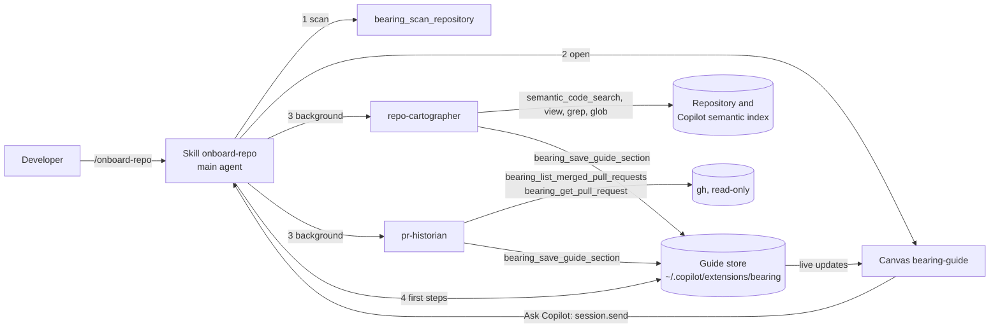

# Bearing V2

Bearing is a prototype plugin for the GitHub Copilot app. It onboards a developer to a small repository:
a codebase map from the Copilot semantic index, key coding conventions, the development workflow, and
step-by-step walkthroughs of recently merged pull requests, all in an interactive canvas.

For installation and use, see [plugins/bearing/README.md](plugins/bearing/README.md).

## Layout

```text
.github/plugin/marketplace.json     Marketplace that lists the plugin
plugins/bearing/
├── plugin.json                     Plugin manifest (agents, skills, extensions paths)
├── skills/onboard-repo/            Entry point: /onboard-repo
│   ├── SKILL.md
│   └── references/                 Dispatch prompts and first-steps rules (read on demand)
├── agents/
│   ├── repo-cartographer.agent.md  Maps the code; saves 5 sections
│   └── pr-historian.agent.md       Writes the pull request walkthroughs
└── extensions/bearing/
    ├── extension.mjs               Wiring only: 5 tools and the bearing-guide canvas
    ├── lib/                        Scan, guide store, light checks, gh calls, canvas server, prompts
    └── ui/                         Canvas page (HTML, CSS, JavaScript; no dependencies)
test/                               node:test tests and a sample guide
```

## How it works



| Part | Why it is this kind of component |
|---|---|
| Skill `onboard-repo` | It runs in the main agent, which owns the conversation and the canvas and can start subagents. The reference files load only when needed. |
| Agents | Heavy reading stays out of the main context. Both run at the same time, are hidden from the agent picker, and get only the tools they need (no shell). |
| Extension | Facts that code can find (git data, languages, hotspots), storage, light checks on saved data, read-only `gh` calls, and the canvas. |

The save tool does light checks only: it cuts long lists and text, removes references to files that do not exist and line
ranges that are not valid, and returns warnings. Missing required fields are the only errors.

## Platform facts that shaped the design

These come from a spike in the Copilot app (2026-10).

- Agent `tools` must use exact names: `view`, `grep`, `glob`, `semantic_code_search`, and the extension tool names.
  The `search` alias maps to no tool, and unknown names are dropped without an error.
- The app includes `gh` and `git`, and sets `GH_TOKEN` for extensions, so the pull request tools need no shell for the agents.
- The canvas is a separate webview. The host injects its theme tokens as inline `<style>` elements, so the CSP allows
  inline styles (not inline scripts). `prefers-color-scheme` does not follow the app; use the tokens and `data-theme-tone`.
- The canvas page loads only when its panel is visible. All state is in the guide store, so nothing depends on the page.
- After `extensions_reload`, the runtime opens the canvas again on the new server.

## Development

Requirements: Node.js 22 or later, and the GitHub Copilot app.

```bash
npm test
```

Install your working copy as a live plugin. New sessions load the files from your clone; nothing is copied.

```bash
copilot plugin marketplace add /path/to/your/clone
copilot plugin install bearing@bearing-marketplace
```

- After you change the extension, ask Copilot to reload the extensions (`extensions_reload`). An open canvas reconnects.
- After you change an agent or the skill, start a new session.
- To work on the canvas without the agents, load the sample guide into the store, then open the canvas with
  `guideId` `expressjs__cors`:

  ```bash
  git clone https://github.com/expressjs/cors.git /tmp/cors
  node test/fixtures/load-sample.mjs /tmp/cors
  ```

- A session that started before you installed the plugin does not load it. To test in such a session, add a session-scoped
  extension, `<session folder>/extensions/bearing-dev/extension.mjs`, that imports `plugins/bearing/extensions/bearing/extension.mjs`.

## Status

Prototype. Tested end to end on `expressjs/cors` (JavaScript) and `spf13/pflag` (Go).
