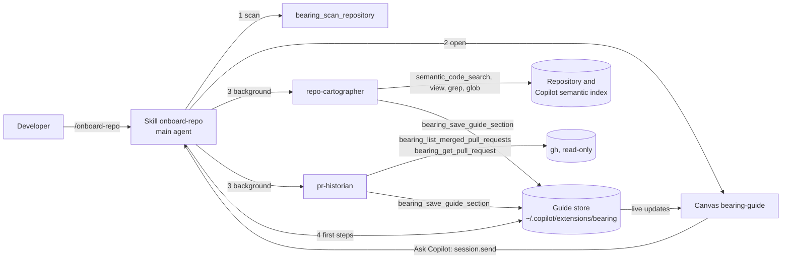

# Bearing V2

Bearing is a prototype plugin for the GitHub Copilot app. It onboards a developer to a small repository:
a codebase map from the Copilot semantic index, key coding conventions, the development workflow, and
step-by-step walkthroughs of recently merged pull requests, all in an interactive canvas.

For installation and use, see [plugins/bearing/README.md](plugins/bearing/README.md).
Hackathon submission copy, the demo plan, and the slide deck live in [submission/](submission/README.md).

## Enterprise relevance

Bearing targets a recurring engineering productivity problem: developers moving into an unfamiliar service spend their
first hours or days reconstructing context from scattered documentation, code, tribal knowledge, and pull request history.
The immediate user is a new or rotating developer; engineering enablement, platform engineering, and service owners benefit
from a repeatable onboarding experience that does not require every team to maintain a bespoke portal. Relevant scenarios
include internal mobility, acquisition integration, ownership transfer, incident support, and onboarding consultants or
partners to a bounded codebase.

## Workflow transformation

Bearing transforms a manual onboarding ritual into a reusable GitHub Copilot App workflow:

| Stage | Before | With Bearing |
|---|---|---|
| Plan | A developer guesses where to begin or waits for a service owner. | The skill scopes the repository, detects available context, and opens a consistent guide structure. |
| Delegate | One person manually searches code, docs, and pull requests. | A coordinating agent delegates repository mapping and change-history research to role-scoped specialists in parallel. |
| Validate | Notes and chat answers are difficult to trace. | Claims link to files and pull requests; invalid references are removed and missing evidence is marked unavailable. |
| Review | Knowledge transfer depends on a synchronous walkthrough. | The developer reviews a live canvas, opens evidence, asks focused follow-ups, and decides what to trust. |
| Scale | Every team invents its own onboarding document or session. | The same plugin, instructions, controls, and measures can be piloted and reused across eligible repositories. |

## Layout

```text
.github/plugin/marketplace.json     Marketplace that lists the plugin
plugins/bearing/
├── plugin.json                     Plugin manifest (agents, skills, extensions paths)
├── skills/onboard-repo/            Entry point: /onboard-repo
│   ├── SKILL.md
│   └── references/                 Dispatch prompts and first-steps rules (read on demand)
├── agents/
│   ├── repo-cartographer.agent.md  Maps the code; saves 5 sections
│   └── pr-historian.agent.md       Writes the pull request walkthroughs
└── extensions/bearing/
    ├── extension.mjs               Wiring only: 5 tools and the bearing-guide canvas
    ├── lib/                        Scan, guide store, light checks, gh calls, canvas server, prompts
    └── ui/                         Canvas page (HTML, CSS, JavaScript; no dependencies)
test/                               node:test tests and a sample guide
```

## How it works



| Part | Why it is this kind of component |
|---|---|
| Skill `onboard-repo` | It runs in the main agent, which owns the conversation and the canvas and can start subagents. The reference files load only when needed. |
| Agents | Heavy reading stays out of the main context. Both run at the same time, are hidden from the agent picker, and get only the tools they need (no shell). |
| Extension | Facts that code can find (git data, languages, hotspots), storage, light checks on saved data, read-only `gh` calls, and the canvas. |

The save tool does light checks only: it cuts long lists and text, removes references to files that do not exist and line
ranges that are not valid, and returns warnings. Missing required fields are the only errors.

## Roles

| Role | Responsibility |
|---|---|
| Developer | Starts onboarding, chooses whether to reuse or refresh an existing guide, checks important claims, asks follow-up questions, and decides what work to do. |
| Service owner or engineering manager | Reviews the guide against known architecture and policy, resolves gaps, and approves the repository for broader use. |
| Enablement, platform, or field team | Selects pilot repositories, communicates the customer-ready narrative, measures outcomes, and scales the pattern under enterprise controls. |
| Main Copilot agent | Scans the repository, opens the canvas, coordinates the specialist agents, handles failures, and creates the first-contribution checklist. |
| Repository cartographer | Uses the semantic index and repository files to map architecture, conventions, workflow, and the best reading order. |
| Pull request historian | Uses read-only GitHub data to explain the latest merged pull requests as step-by-step codebase lessons. |
| Bearing extension and canvas | Provides deterministic scanning, storage, validation, GitHub retrieval, live guide updates, navigation, and Ask Copilot actions. |

## Prerequisites

- GitHub Copilot app with canvas and plugin support.
- Git and Node.js 22 or later for local development and tests.
- GitHub CLI authentication for recent pull request walkthroughs. The app provides `gh`.
- A small repository, ideally about 2,000 tracked files or fewer, with a GitHub remote for the complete experience.

## Adoption path

1. **Pilot:** install Bearing for one well-understood repository and compare its guide with the service owner's expectations.
2. **Calibrate:** refine repository documentation and agent instructions where the evidence reveals gaps or ambiguity.
3. **Enable:** give developers the same `/onboard-repo` entry point and a short verification checklist.
4. **Measure:** track time to orientation, evidence coverage, guide completeness, and first-task readiness.
5. **Scale:** expand to similar repositories after the organization approves data handling, tool permissions, retention,
   and review expectations. Large repositories and monorepos need further product hardening.

## Governance considerations

- Bearing is read-only: it does not change the target repository or run its install, build, or test commands.
- Repository files and pull request text are treated as untrusted data, not instructions for the agents.
- Claims are grounded in files the agents read; observed conventions require evidence from at least three files.
- Guides and checklist progress are stored locally under the Copilot extension data directory and can be deleted by the user.
- Pull request access uses read-only `gh` calls. The extension does not store a GitHub token.
- The canvas binds to loopback only and uses a per-instance secret token for guide reads and actions.
- The prototype is intended for small repositories on github.com; important facts still require developer verification.
- Production adoption should additionally define repository eligibility, organization-approved model and retention policies,
  audit requirements, access reviews, and an owner responsible for validating the generated onboarding experience.

## Human-in-the-loop model

The developer deliberately starts Bearing and retains the decisions that matter. They choose whether to open or rebuild
an existing guide, see sections arrive while research runs, verify cited code and pull request evidence, and use focused
Ask Copilot actions to resolve uncertainty. Bearing stops at orientation: it proposes a first-contribution path but does
not edit code, execute repository commands, or begin implementation. The developer decides whether any recommended work
is correct and safe.

## Success measures

These measures are appropriate for a field trial; the prototype does not yet collect telemetry.

- **Time to orientation:** minutes from `/onboard-repo` to a complete or explicitly unavailable seven-section guide.
- **Evidence coverage:** share of architecture, convention, and workflow claims linked to repository files or pull requests.
- **Guide completeness:** number of sections reaching `ready` rather than remaining `pending`.
- **First-task readiness:** whether a new developer can identify the files, commands, and next steps for a first contribution.
- **Safe operation:** no target-repository changes, no repository commands executed, and no credentials persisted.

## Platform facts that shaped the design

These come from a spike in the Copilot app (2026-10).

- Agent `tools` must use exact names: `view`, `grep`, `glob`, `semantic_code_search`, and the extension tool names.
  The `search` alias maps to no tool, and unknown names are dropped without an error.
- The app includes `gh` and `git`, and sets `GH_TOKEN` for extensions, so the pull request tools need no shell for the agents.
- The canvas is a separate webview. The host injects its theme tokens as inline `<style>` elements, so the CSP allows
  inline styles (not inline scripts). `prefers-color-scheme` does not follow the app; use the tokens and `data-theme-tone`.
- The canvas page loads only when its panel is visible. All state is in the guide store, so nothing depends on the page.
- After `extensions_reload`, the runtime opens the canvas again on the new server.

## Development

Requirements: Node.js 22 or later, and the GitHub Copilot app.

```bash
npm test
```

Install your working copy as a live plugin. New sessions load the files from your clone; nothing is copied.

```bash
copilot plugin marketplace add /path/to/your/clone
copilot plugin install bearing@bearing-marketplace
```

- After you change the extension, ask Copilot to reload the extensions (`extensions_reload`). An open canvas reconnects.
- After you change an agent or the skill, start a new session.
- To work on the canvas without the agents, load the sample guide into the store, then open the canvas with
  `guideId` `expressjs__cors`:

  ```bash
  git clone https://github.com/expressjs/cors.git /tmp/cors
  node test/fixtures/load-sample.mjs /tmp/cors
  ```

- A session that started before you installed the plugin does not load it. To test in such a session, add a session-scoped
  extension, `<session folder>/extensions/bearing-dev/extension.mjs`, that imports `plugins/bearing/extensions/bearing/extension.mjs`.

## Status

Prototype. Tested end to end on `expressjs/cors` (JavaScript) and `spf13/pflag` (Go).
